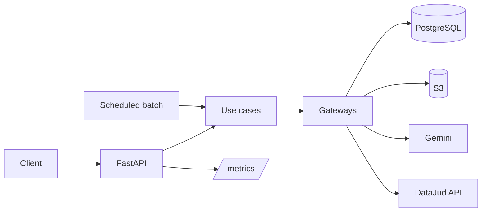

# Controladoria API

> A document/data platform built with **FastAPI** in clean architecture: ingests and classifies
> documents, extracts structured data with an LLM, syncs legal-process data, and serves
> dashboards — with S3 storage, Alembic migrations, scheduled batch processing, Terraform IaC,
> and Prometheus metrics.


## What this demonstrates

- **Clean / hexagonal architecture** — `domain` (entities, gateways, repositories, use cases)
  decoupled from `infra` (database, external services, config).
- **Data platform engineering** — S3 object storage, Alembic schema migrations, and a
  rate-limited **scheduled batch job** that syncs external legal-process data (DataJud).
- **Infrastructure as Code & CI/CD** — Terraform (HCL) and a GitHub Actions deploy workflow.
- **Observability** — a `/metrics` endpoint for Prometheus scraping.
- **LLM-assisted extraction** — document classification and structured-data extraction via
  Gemini.

## Architecture



## Tech stack

Python · FastAPI · PostgreSQL · SQLAlchemy + Alembic · AWS S3 · Terraform · Docker /
docker-compose · GitHub Actions · Prometheus · Google Gemini.

## Configuration

| Variable | Description |
| --- | --- |
| `DATABASE_URL` | PostgreSQL connection string |
| `GOOGLE_API_KEY` | Gemini key for classification/extraction |
| `DATAJUD_URL` / `DATAJUD_API_KEY` | Legal-process lookup credentials |
| `AWS_REGION` | S3 region (default `sa-east-1`) |
| `S3_BUCKET` | Document storage bucket |
| `AWS_ACCESS_KEY_ID` / `AWS_SECRET_ACCESS_KEY` | S3 credentials |
| `SCHED_TIMEZONE` | Cron timezone (default `America/Sao_Paulo`) |
| `CRON_BATCH_SIZE` | Processes updated per run (default `20`) |
| `EXTERNAL_RPM` | External-call rate limit (default `60`) |

Copy `.env.example` → `.env` and fill values. **Never commit real credentials.**

## Quickstart

```bash
pip install -r requirements.txt
alembic upgrade head          # run migrations
uvicorn main:app --reload     # dev server
# or:
docker compose up
```

API docs at `/docs`; metrics at `/metrics` (authenticated). Endpoint specs live in `docs/*.md`.

## Project structure

```
src/
  domain/      # core, entities, gateways, repositories, usecases
  infra/       # config, database (models, repositories, session), external (dto)
alembic/       # migrations
docs/          # endpoint + cron documentation
.github/workflows/deploy.yml
Dockerfile  docker-compose.yml  requirements.txt  main.py
```

## License

MIT (add a `LICENSE` file).
